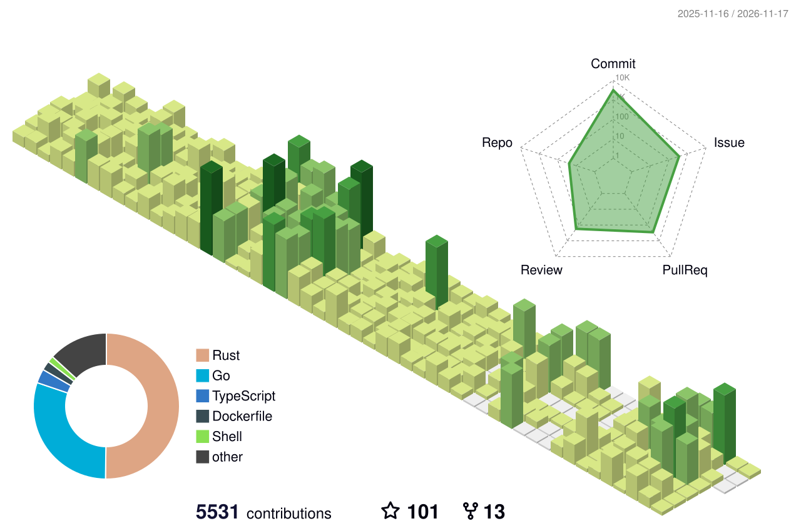

<h1 align="center">
  <em>
    Cheems Chen
  </em>
</h1>

  <em>Still figuring this shit out and enjoying the absurdity along the way.</em> 
  <em>Lately AI agents and developer tools. Before that, trading systems.</em>

  <em>
    ex-<a href="https://github.com/nexu-io">@OpenDesign</a>
    · ex-<a href="https://github.com/megvii-research">@Megvii</a>
    · ex-<a href="https://github.com/tencent">@Tencent</a>
  </em>

  
  
  
  
  
  
  
  
  
  

<!--

-->

## GitHub Activity

